# Hi, I'm a PHP & Laravel developer 👋

Based in Germany 🇩🇪 · Working remotely 🌍

I build useful things with Laravel and Vue.js. I care about clean code, open source, and learning new things.

## 📦 My packages

- [Query Filter Laravel](https://github.com/plutuss/query-filter-laravel) — filter Eloquent queries with validation and Livewire support.
- [aMember Pro Laravel](https://github.com/plutuss/amember-pro-laravel) — a Laravel REST API client for aMember Pro.
- [getID3 Laravel](https://github.com/plutuss/getid3) — extract audio and video metadata and validate media uploads.
- [Laravel GeoNames API](https://github.com/plutuss/geo-laravel) — access geographic data from the GeoNames API.
- [HERE Coding Geo](https://github.com/plutuss/here-coding-geo) — geocoding, reverse geocoding and routing with HERE Maps.
- [GIF Creator Laravel](https://github.com/plutuss/gif-creator) — create animated GIFs in Laravel.
- [Sortable Laravel](https://github.com/plutuss/sortable-laravel) — sorting support for Laravel.

## Tech stack

**Backend**

**Frontend**

**Data & infrastructure**

**Version control**

## GitHub activity

## 🏆 GitHub trophies

## ✍️ Random dev quote

## 🔝 Top contributed repositories

## Support

If you find my work useful, you can [support me on PayPal](https://paypal.me/dima92konovalenko@gmail.com).
